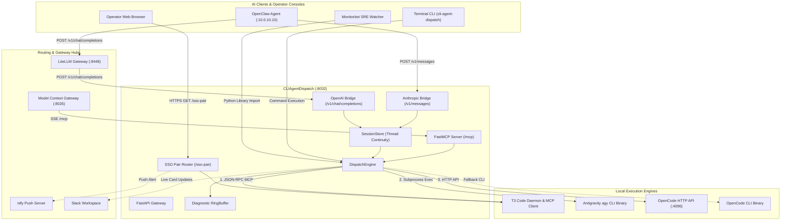
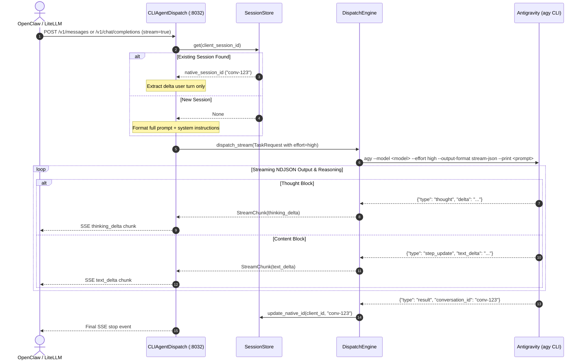
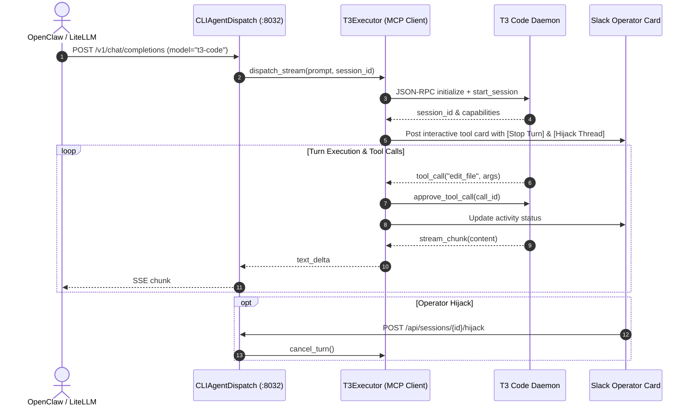
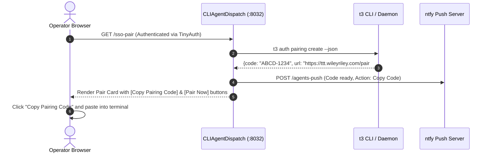
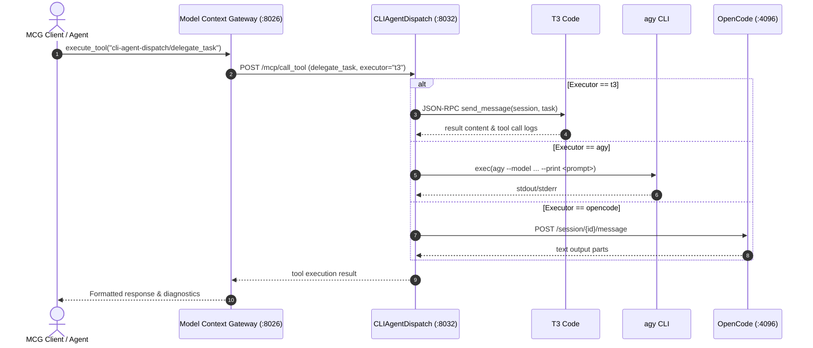

# ARCHITECTURE.md: CLIAgentDispatch

## 🏛️ System Topology

---

## 🔄 Sequence: Anthropic & OpenAI Streaming Delegation with Extended Reasoning

---

## 🔄 Sequence: T3 Code Headless Execution & Mid-Thread Model Switching

---

## 🔄 Sequence: SSO Web Pairing (`/sso-pair`) & ntfy Push Alert

---

## 🔄 Sequence: FastMCP Tool Delegation

---

## 📊 Endpoints & Routing Contract

| Endpoint | Method | Protocol | Description |
| :--- | :--- | :--- | :--- |
| `/v1/chat/completions` | `POST` | OpenAI HTTP / SSE | OpenAI compatible chat completions with multi-turn continuity & `reasoning_delta` |
| `/v1/models` | `GET` | OpenAI HTTP | Dynamic model enumeration across all underlying engines |
| `/v1/messages` | `POST` | Anthropic HTTP / SSE | Anthropic Messages API with `thinking_delta` streaming blocks |
| `/v1/screenshot` | `GET` | Binary / JSON | Real-time screenshot probe for visual debugging |
| `/mcp` / `/sse` | `GET`/`POST`| FastMCP | Model Context Protocol gateway with 9 native SRE/delegation tools |
| `/sso-pair` | `GET` | HTML / JSON | Interactive SSO pairing portal with one-click token copy |
| `/health` | `GET` | HTTP JSON | Shallow health probe and service version metadata |
| `/api/diagnostics` | `GET` | HTTP JSON | Detailed engine health, ring-buffer logs, and active session status |
